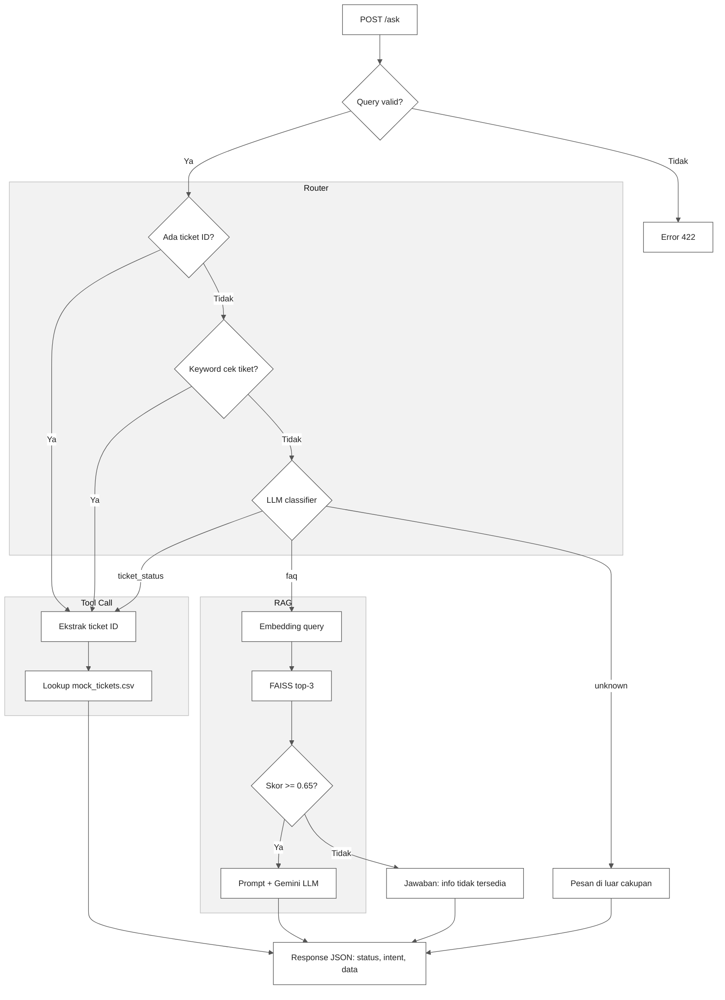

# IT Helpdesk Assistant: RAG + Mini-Agent Router

Backend API **FastAPI** untuk asisten AI internal tim People & IT Operations. Satu endpoint `/ask` menangani dua jenis permintaan karyawan:

1. **Pertanyaan kebijakan/informasi.** Dijawab dengan **RAG** (FAISS + Gemini) dari knowledge base.
2. **Permintaan cek status tiket.** Dijawab dengan **tool call** (lookup langsung ke data tiket), bukan retrieval semantik.

Aplikasi dikemas dalam **Docker**, dan API key dikelola lewat **environment variables**.

---

## Daftar Isi
1. [Problem Statement](#1-problem-statement)
2. [Desain Workflow](#2-desain-workflow)
3. [Kriteria Intent](#3-kriteria-intent)
4. [Detail Komponen](#4-detail-komponen)
5. [Struktur Project](#5-struktur-project)
6. [Cara Menjalankan](#6-cara-menjalankan)
7. [Kontrak API](#7-kontrak-api)
8. [Hasil Pengujian](#8-hasil-pengujian)
9. [Keterbatasan Sistem](#9-keterbatasan-sistem)

---

## 1. Problem Statement

### Objective
Tim People & IT Operations menerima ratusan pertanyaan repetitif setiap hari. Tujuan use case ini adalah membangun **prototype backend API** yang menjawab pertanyaan tersebut secara otomatis dalam **satu sistem**, sehingga beban tim berkurang dan karyawan mendapat jawaban instan yang **konsisten dengan kebijakan resmi**. Sistem ini juga harus siap diserahkan ke tim infrastruktur dalam bentuk container Docker.

### Dua jenis permintaan user

| Jenis | Karakteristik | Contoh | Ditangani oleh |
|---|---|---|---|
| **Informasi / kebijakan** (`faq`) | Jawabannya ada di dokumen kebijakan. Pertanyaan bisa diungkapkan dengan berbagai cara, sehingga butuh pencarian **semantik**. | "Berapa jatah cuti tahunan saya?"<br>"Bagaimana cara reset password VPN?" | **RAG** |
| **Aksi / pengecekan data** (`ticket_status`) | Jawabannya adalah data spesifik milik satu record yang harus dicocokkan **persis** berdasarkan ID. | "Apa status tiket TICKET-0042 saya?"<br>"Cek tiket TICKET-0005" | **Tool call** |

**Kenapa status tiket tidak memakai RAG?** Semantic search mencari teks yang *mirip*, bukan yang *sama persis*. Untuk query `TICKET-0050`, retrieval bisa mengembalikan `TICKET-0005` karena bentuknya mirip, dan itu jawaban yang **salah**. Data terstruktur dengan kunci unik harus diambil lewat lookup langsung.

### Batasan & asumsi
- Knowledge base hanya berisi **31 FAQ** di `data/it_helpdesk_knowledge_base.csv`. Pertanyaan di luar itu dijawab "tidak tersedia", bukan dikarang.
- Data tiket berupa **mock** (`data/mock_tickets.csv`, 15 tiket `TICKET-0001` s/d `TICKET-0015`) dan bersifat read-only. Sistem hanya **membaca** status, tidak membuat atau mengubah tiket.
- Format ID tiket resmi adalah `TICKET-XXXX`. User diasumsikan bisa menulis variasi seperti `TICKET0042`, `ticket 42`, atau `tiket no 7`, dan semuanya dinormalisasi.
- **Belum ada autentikasi user**, jadi siapa pun bisa mengecek tiket mana pun dan jawaban kebijakan tidak dipersonalisasi (misal "sisa cuti *saya*").
- Satu query diasumsikan berisi **satu intent**.
- Bahasa utama Indonesia (termasuk bahasa informal seperti "gimana", "dong").
- Bergantung pada **Gemini API** (butuh internet & API key). Prototype ini dijalankan lokal, tidak di-deploy ke cloud.

---

## 2. Desain Workflow



**Ringkasnya:** `query → validasi → intent detection (rule → keyword → LLM) → RAG atau tool call → response {status, intent, data}`.

Desain router dibuat **berlapis dari yang paling murah**. Permintaan tiket yang menyebut ID (kasus paling umum) langsung dikenali lewat regex. Cara ini cepat (sekitar 0 ms), deterministik, dan tidak memakai kuota API. LLM hanya dipakai untuk query yang tidak bisa diputuskan oleh rule.

---

## 3. Kriteria Intent

| Intent | Kriteria | Dideteksi oleh | Contoh |
|---|---|---|---|
| `ticket_status` | Query **memuat ID tiket** (`TICKET-0005`, `ticket0042`, `TICKET 12`) | Lapis 1: regex `\bticket[\s\-_#]*(\d{1,6})\b` | "Status TICKET-0005?" |
| `ticket_status` | Query memuat kata **tiket/ticket** **dan** kata **pengecekan** (`status`, `cek`, `lacak`, `progres`, `update`, `sampai mana`, ...) | Lapis 2: keyword | "Tiket saya sudah sampai mana?" |
| `ticket_status` | Permintaan cek progres tiket yang tidak tertangkap rule | Lapis 3: LLM | "Laporan laptop rusak saya sudah diproses belum?" |
| `faq` | Pertanyaan **informasi/kebijakan/prosedur** seputar IT & HR: cuti, absensi, akses, password, perangkat, onboarding, payroll, kebijakan kerja, tools. Termasuk "bagaimana cara **membuat** tiket" (prosedur, bukan cek status). | Lapis 3: LLM | "Berapa jatah cuti tahunan?" |
| `unknown` | Sapaan kosong, pesan tidak jelas, atau topik **di luar lingkup IT/HR** (cuaca, resep, berita, dll.) | Lapis 3: LLM | "Bagaimana cuaca di Jakarta?" |

**Pembeda utama `faq` vs `ticket_status`:** `faq` menanyakan **aturan umum** yang berlaku untuk semua karyawan, sedangkan `ticket_status` menanyakan **data satu record spesifik** (satu tiket) yang hanya bisa dijawab dengan melihat database.

**Fallback:** jika LLM classifier gagal (timeout/kuota habis), intent di-fallback ke `faq`. Ini aman karena RAG punya penjaga relevansi sendiri (lihat bagian 4).

---

## 4. Detail Komponen

### RAG: [app/rag.py](app/rag.py)
| Tahap | Implementasi |
|---|---|
| Unit retrievable | 1 baris FAQ = `Kategori + Pertanyaan + Jawaban` (31 dokumen). FAQ sudah pendek dan utuh, jadi tidak perlu chunking. |
| Embedding | `gemini-embedding-001` (dimensi 3072), dengan `task_type=RETRIEVAL_DOCUMENT` untuk dokumen dan `RETRIEVAL_QUERY` untuk query. Dokumen di-embed dalam **satu batch request**. |
| Index | `faiss.IndexFlatIP` atas vektor yang dinormalisasi L2, sehingga inner product = **cosine similarity**. Dibangun **sekali saat startup** (FastAPI `lifespan`), bukan per request. |
| Search | Top-3 dokumen beserta skor. |
| Penjaga relevansi | Jika skor tertinggi **< 0.65**, sistem langsung menjawab "tidak menemukan informasi" **tanpa memanggil LLM** untuk mencegah halusinasi. Threshold dikalibrasi dari data: query relevan mendapat skor 0.75–0.80, query di luar topik maksimal 0.62. |
| Prompt | Terstruktur **Persona / Task / Context / Format**. Ada instruksi eksplisit untuk menjawab *hanya* dari context dan memakai kalimat penolakan baku jika context tidak memuat jawaban. |
| LLM | `gemini-3.5-flash-lite` (temperature 0.2) dengan fallback otomatis ke `gemini-3.1-flash-lite` jika model utama gagal. Dipanggil async (`client.aio`). |

> Model `text-embedding-004` di starter repo sudah tidak tersedia di Gemini API, sehingga diganti dengan `gemini-embedding-001`.

### Tool call: [app/tools.py](app/tools.py)
- `find_ticket(ticket_id)` mencari baris dengan ID yang **sama persis** (case-insensitive). CSV dimuat sekali dan di-cache (`lru_cache`).
- `get_ticket_status(ticket_id)` menyusun jawaban (kategori, subject, status, last update, pemohon).
- **Tidak pernah crash.** ID kosong atau tidak ditemukan menghasilkan pesan informatif.

### Router: [app/router.py](app/router.py)
- `detect_intent()` menjalankan router hybrid 3 lapis (lihat bagian 3). Output LLM dibersihkan (`_parse_intent`) sehingga jawaban seperti `"Faq."` atau `"**faq**"` tetap terbaca, dan label tak dikenal menjadi `unknown`.
- `extract_ticket_id()` menormalisasi variasi penulisan ke format data: `ticket0042` → `TICKET-0042`, `tiket no 7` → `TICKET-0007`.

### API & error handling: [app/main.py](app/main.py)
| Kondisi | HTTP | Response |
|---|---|---|
| Sukses (FAQ / tiket ditemukan) | 200 | `status=success` |
| Tiket tidak ada / ID tidak disebut | 200 | `status=not_found` / `missing_ticket_id` |
| Intent tidak dikenali / di luar cakupan | 200 | `status=error`, `intent=unknown` |
| Query kosong / body JSON tidak valid | 422 | `status=error` |
| LLM / embedding gagal merespons | 503 | `status=error`, pesan "coba lagi" |
| Error tak terduga | 500 | `status=error` (detail hanya di log server) |

Jika index gagal dibangun saat startup (misal API key salah), aplikasi **tetap hidup**. Cek tiket tetap berfungsi, dan index dicoba dibangun ulang secara lazy pada request FAQ berikutnya.

### Konfigurasi (environment variables)
| Variabel | Wajib | Default | Keterangan |
|---|---|---|---|
| `GEMINI_API_KEY` | ✅ | – | API key Gemini. **Tidak pernah di-hardcode.** |
| `EMBEDDING_MODEL` | | `gemini-embedding-001` | Model embedding |
| `LLM_MODEL` | | `gemini-3.5-flash-lite` | Model LLM utama |
| `RELEVANCE_THRESHOLD` | | `0.65` | Skor cosine minimum untuk RAG |

---

## 5. Struktur Project

```
it-helpdesk-assignment/
├── app/
│   ├── __init__.py
│   ├── main.py          # FastAPI: endpoint /ask & /health, error handling, startup index
│   ├── router.py        # Intent detection hybrid + ekstraksi ticket_id + routing
│   ├── rag.py           # Embedding, FAISS, semantic search, prompt, panggilan LLM
│   └── tools.py         # Tool call: lookup status tiket
├── data/
│   ├── it_helpdesk_knowledge_base.csv   # 31 FAQ (knowledge base RAG)
│   └── mock_tickets.csv                 # 15 tiket mock (data tool call)
├── tests/
│   └── test_scenarios.py   # Pengujian end-to-end /ask (8 skenario)
├── docs/
│   ├── test_results_local.txt    # Output pengujian, dijalankan lokal
│   └── test_results_docker.txt   # Output pengujian, dijalankan di container
├── Dockerfile
├── .dockerignore        # .env, .venv, dll. tidak ikut masuk image
├── .env.example         # Template environment variables (tanpa key asli)
├── .gitignore           # .env tidak ikut ter-commit
├── requirements.txt
└── README.md
```

---

## 6. Cara Menjalankan

### Persiapan (sekali saja)
```bash
git clone https://github.com/luluahb/assignment-helpdesk-agent-lulu.git
cd assignment-helpdesk-agent-lulu

cp .env.example .env          # Windows PowerShell: Copy-Item .env.example .env
# buka .env lalu isi GEMINI_API_KEY dengan API key milikmu
```
API key bisa dibuat di [Google AI Studio](https://aistudio.google.com/apikey).

### A. Lokal (tanpa Docker)
Membutuhkan Python 3.11+.
```bash
python -m venv .venv
# Windows:      .venv\Scripts\activate
# macOS/Linux:  source .venv/bin/activate

pip install -r requirements.txt
uvicorn app.main:app --reload
```
Server berjalan di `http://127.0.0.1:8000`. File `.env` dibaca otomatis lewat `python-dotenv`.

### B. Docker
Membutuhkan [Docker Desktop](https://www.docker.com/products/docker-desktop/) yang sedang berjalan.
```bash
# Build image
docker build -t it-helpdesk-assistant .

# Jalankan container; API key diberikan saat runtime, BUKAN dimasukkan ke image
docker run -d --name helpdesk -p 8000:8000 --env-file .env it-helpdesk-assistant

# Lihat log (tunggu "Index FAISS siap" & "Application startup complete")
docker logs -f helpdesk

# Hentikan & hapus container
docker stop helpdesk && docker rm helpdesk
```
`-p 8000:8000` memetakan port container ke host, sehingga `/ask` dapat diakses dari luar container di `http://localhost:8000`.

**Kenapa `.env` aman?** File ini tercantum di `.gitignore` (tidak ter-commit) dan `.dockerignore` (tidak masuk ke image). Sudah diverifikasi: isi `/app` di dalam image hanya `app/`, `data/`, dan `requirements.txt`.

### Mencoba endpoint
- **Swagger UI:** buka `http://127.0.0.1:8000/docs`, pilih `POST /ask`, klik **Try it out**.
- **curl:**
  ```bash
  curl -X POST http://127.0.0.1:8000/ask \
    -H "Content-Type: application/json" \
    -d '{"query": "berapa jatah cuti tahunan saya?"}'
  ```
- **PowerShell:**
  ```powershell
  Invoke-RestMethod -Method Post -Uri http://127.0.0.1:8000/ask `
    -ContentType "application/json" -Body '{"query": "cek status TICKET-0005"}'
  ```
- **Script pengujian (8 skenario):**
  ```bash
  python tests/test_scenarios.py                 # default http://127.0.0.1:8000
  ```

---

## 7. Kontrak API

### `POST /ask`
**Request**
```json
{ "query": "Apa status tiket TICKET-0005 saya?" }
```
**Response**
```json
{
  "status": "success",
  "intent": "ticket_status",
  "data": "Tiket TICKET-0005 (Access): Reset password VPN gagal terus. Status: Diproses. Terakhir diperbarui: 2026-08-27. Pemohon: Dedi Kurniawan."
}
```
| Field | Nilai |
|---|---|
| `status` | `success` · `not_found` · `missing_ticket_id` · `error` |
| `intent` | `faq` · `ticket_status` · `unknown` |
| `data` | Jawaban / pesan untuk user (string) |

### `GET /health`
```json
{ "status": "ok", "index_ready": true }
```

---

## 8. Hasil Pengujian

Pengujian dijalankan dengan `tests/test_scenarios.py` terhadap **server lokal** dan **container Docker**. Keduanya menghasilkan routing yang identik: **8/8 benar**. Output lengkap ada di [docs/test_results_local.txt](docs/test_results_local.txt) dan [docs/test_results_docker.txt](docs/test_results_docker.txt).

### 5 skenario wajib

| # | Skenario | Query | Intent diharapkan | Intent hasil | Status | Response (`data`) |
|---|---|---|---|---|---|---|
| 1 | RAG: kebijakan cuti | *Berapa jatah cuti tahunan saya sebagai karyawan tetap?* | `faq` | `faq` ✅ | success | Karyawan tetap mendapat jatah 12 hari cuti tahunan. Jatah tersebut dapat diambil setelah masa kerja minimal 3 bulan. |
| 2 | RAG: reset VPN | *Gimana cara reset password VPN kantor?* | `faq` | `faq` ✅ | success | Reset password VPN dapat dilakukan secara mandiri melalui portal self-service IT. Selain itu, Anda juga dapat menghubungi tim IT Support jika akun terkunci. |
| 3 | Tool: tiket ada | *Tolong cek status tiket TICKET-0005 saya dong* | `ticket_status` | `ticket_status` ✅ | success | Tiket TICKET-0005 (Access): Reset password VPN gagal terus. Status: Diproses. Terakhir diperbarui: 2026-08-27. Pemohon: Dedi Kurniawan. |
| 4 | Tool: tiket **tidak ada** | *Apa status tiket TICKET0042 saya?* | `ticket_status` | `ticket_status` ✅ | not_found | Tiket TICKET-0042 tidak ditemukan di sistem. Mohon periksa kembali nomor tiket Anda atau hubungi tim IT Support. |
| 5 | Ambigu / di luar cakupan | *Bagaimana cuaca di Jakarta hari ini?* | `unknown` | `unknown` ✅ | error | Maaf, saya tidak memahami permintaan Anda atau permintaan tersebut di luar cakupan IT Helpdesk. Saya dapat membantu pertanyaan seputar kebijakan IT/HR (...) atau pengecekan status tiket (contoh: 'cek status TICKET-0005'). |

### Skenario tambahan

| # | Skenario | Query | Intent hasil | Status | Response (`data`) |
|---|---|---|---|---|---|
| 6 | Cek tiket tanpa ID | *Tiket saya sudah sampai mana ya statusnya?* | `ticket_status` ✅ | missing_ticket_id | Nomor tiket tidak ditemukan pada pesan Anda. Mohon sertakan nomor tiket dengan format TICKET-XXXX (contoh: TICKET-0005). |
| 7 | Topik HR tapi tidak ada di KB | *Apakah kantor menyediakan fasilitas gym?* | `faq` ✅ | success | Maaf, informasi tersebut tidak tersedia di knowledge base. Silakan hubungi tim IT Support atau HR. |
| 8 | Query kosong | `"   "` | `unknown` ✅ | error (HTTP 422) | Query tidak boleh kosong. |
| 9 | LLM gagal (API key sengaja dibuat salah) | *Berapa jatah cuti saya?* / *cek status TICKET-0003* | `faq` / `ticket_status` | error (HTTP 503) / success | FAQ: "Layanan AI sedang tidak dapat merespons..." · Tiket: tetap dijawab normal |

### Observasi
1. **Router mengarahkan semua query ke komponen yang tepat (8/8).** Skenario 1–2 masuk ke RAG, skenario 3–4 ke tool call, dan skenario 5 ditolak sebagai `unknown`.
2. **Jawaban RAG akurat dan grounded.** Angka "12 hari" dan "minimal 3 bulan" (skenario 1) serta "portal self-service IT" (skenario 2) sama persis dengan FAQ #1 dan #8. Bahasa informal ("gimana", "kantor") tetap ter-retrieve dengan skor tinggi (~0.80).
3. **Normalisasi ID tiket bekerja.** Query `TICKET0042` (tanpa strip, sesuai contoh di brief) dinormalisasi menjadi `TICKET-0042`, lalu dinyatakan tidak ditemukan dengan pesan yang jelas, tanpa crash.
4. **Tool call jauh lebih cepat.** Query tiket dengan ID terjawab dalam ~0 ms karena terdeteksi regex (tanpa LLM), sementara query FAQ butuh ~2–5 detik (embedding + LLM).
5. **Sistem "tahu bahwa ia tidak tahu" di dua lapis.** Topik di luar lingkup (cuaca) ditolak oleh router. Topik yang relevan tapi tidak ada di KB (gym, skor retrieval 0.70) masuk ke RAG, tetapi LLM mengikuti instruksi prompt dan menolak menjawab alih-alih mengarang.
6. **Degradasi bertahap saat LLM down (skenario 9).** Aplikasi tidak crash. Fitur FAQ mengembalikan 503 dengan pesan yang jelas, sedangkan cek tiket tetap berfungsi karena tidak bergantung pada LLM.
7. **Perilaku identik di lokal dan Docker**, membuktikan container sudah membawa seluruh dependency dan konfigurasi yang dibutuhkan.

---

## 9. Keterbatasan Sistem

1. **Knowledge base kecil dan statis.** Hanya 31 FAQ. Menambah/mengubah FAQ butuh restart aplikasi untuk membangun ulang index (index disimpan di memori, tidak dipersist ke disk).
2. **Tanpa autentikasi & personalisasi.** Siapa pun bisa mengecek tiket milik orang lain (termasuk melihat nama pemohon). Pertanyaan seperti "berapa *sisa* cuti *saya*" hanya dijawab dengan kebijakan umum, bukan data pribadi.
3. **Satu intent per query.** Query gabungan seperti *"cek TICKET-0005 dan berapa jatah cuti?"* hanya diproses sebagai `ticket_status` (rule regex menang), sehingga bagian FAQ diabaikan.
4. **Keterbatasan rule keyword.** Kalimat seperti *"bagaimana cara update tiket saya?"* (pertanyaan prosedur) bisa salah terdeteksi sebagai `ticket_status` karena memuat kata "update" + "tiket". Sebaliknya, permintaan cek progres tanpa kata "tiket" bergantung sepenuhnya pada LLM.
5. **Ekstraksi ID berbasis pola.** Angka setelah kata "tiket" dianggap ID (`tiket 5` → `TICKET-0005`). Nomor tiket yang hanya disebut tanpa kata "tiket/ticket" tidak terdeteksi.
6. **Threshold relevansi dikalibrasi secara manual** dari belasan contoh query. Query yang setengah relevan (skor 0.65–0.72) bergantung pada kepatuhan LLM terhadap prompt untuk menolak menjawab.
7. **Tidak ada memori percakapan.** Setiap request berdiri sendiri, jadi follow-up seperti *"kalau yang 0007?"* tidak dipahami.
8. **Ketergantungan pada Gemini API.** Butuh internet dan kuota. Free tier memiliki rate limit, dan latensi FAQ (2–5 detik) didominasi panggilan API. Satu query FAQ yang tidak tertangkap rule memakai **2 panggilan LLM** (klasifikasi + jawaban) ditambah 1 panggilan embedding.
9. **Data tiket berupa CSV mock**, bukan database/API ticketing sungguhan, dan hanya mendukung operasi baca.

### Ide pengembangan
- Persist index FAISS ke disk dan sediakan endpoint reload knowledge base.
- Autentikasi user (misal SSO) agar tiket hanya bisa dicek oleh pemiliknya dan jawaban bisa dipersonalisasi.
- Function calling native Gemini untuk menggabungkan klasifikasi + ekstraksi entitas dalam satu panggilan, serta mendukung multi-intent.
- Evaluasi router dengan dataset uji berlabel yang lebih besar untuk mengukur akurasi dan mengkalibrasi threshold secara sistematis.

---

## Tech Stack
Python 3.11 · FastAPI · Uvicorn · Pydantic · Pandas · NumPy · FAISS (`faiss-cpu`) · Google Gemini API (`google-genai`): `gemini-embedding-001`, `gemini-3.5-flash-lite` · python-dotenv · Docker
